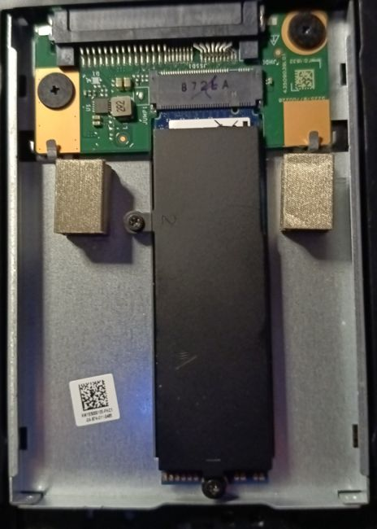

# NEC VersaPro VX-2 — coreboot + EDK2 (experimental port)

> Experimental, unofficial port. Keep a verified backup of the original SPI flash and a known-recoverable external programmer setup. Do not flash another device's complete image. The bundled snapshot is not necessarily ready to flash without integrating its board-specific configuration and required OEM components.

## Hardware test status

The results below cover the tested coreboot 26.09 builds on the VX-2. See the [test matrix](docs/test-matrix.md) for the hardware and firmware details of each result.

| Hardware or function | Status | Verified result or open test |
|---|---|---|
| Internal display and UEFI | ✅ Working | NEC GOP + VBT, graphical EDK II setup and UEFI Shell. |
| External HDMI | ❌ No video | Linux reports `HDMI-A-1` connected and reads a 256-byte EDID after the DDPB GPIO change. The monitor still shows no image. |
| External VGA | ✅ Working | The tester confirmed video output on the VX-2. |
| USB 2.0 | ✅ Working | USB live boot and USB devices on all five ports. |
| USB SuperSpeed | ✅ Working | SuperSpeed operation confirmed on the VX-2. |
| Pre-boot USB keyboard | ✅ Working | USB keyboard input works before the operating system boots. |
| Internal NVMe and Secure Boot | ✅ Working | Ubuntu booted from NVMe with Secure Boot enabled. |
| Windows 11 with Secure Boot | ✅ Working | The tester confirmed Windows 11 boots on the VX-2 with coreboot and UEFI Secure Boot enabled. |
| Secure Boot persistence | 🟡 Needs testing | Verify the setting across cold starts. |
| SD reader | ⚠️ Linux only | The SD write test passed under Linux. The reader does not work under Windows. |
| Internal WLAN | ✅ Working | Tested with a retrofitted Intel AX200. The VX-2 typically shipped with an Intel 8xxx-series WLAN card. |
| Internal WLAN after resume | ✅ Working | WLAN works after resuming from suspend with the retrofitted Intel AX200. |
| SATA, mSATA and SATA optical drive | ✅ Working | The tester confirmed operation on the VX-2. |
| CardBus and PCMCIA | 🟡 Partially verified | A 32-bit FireWire card enumerated and its driver initialized. Transfers and 16-bit PCMCIA are pending. |
| 64 MiB CardBus prefetchable window | ❌ Fails | Allocation failed. The tested card initialized using smaller windows. |
| Sound | ✅ Working | The tester confirmed audio playback. |
| Bluetooth | ✅ Working | Bluetooth functionality confirmed on the VX-2. |
| RJ45 Ethernet | ✅ Working | Wired Ethernet functionality confirmed on the VX-2. |
| Suspend/resume | ✅ Working | The VX-2 suspends and resumes successfully. |
| Internal input | ✅ Working | Internal input works on the VX-2. |
| Battery operation | ✅ Working | The VX-2 operates on battery power. |
| Battery charging | ✅ Working | The battery charges. |
| TPM 2.0 under Linux | ✅ Detected | `tpm_tis` detected TPM 2.0 via `MSFT0101:00`. Linux created `/dev/tpm0` and `/dev/tpmrm0`. TPM command and measured boot validation are pending. |


## Development problems and resolutions

| Problem | Change or finding | Result |
|---|---|---|
| Internal panel stayed black with libgfxinit | eDP AUX and external DDC probes failed to read EDID. Switched to the NEC OEM GOP and matching VBT through EDK II. | **Resolved for the internal display**. External VGA works. HDMI detects the monitor but shows no image. |
| Legacy Intel VGA ROM ran but produced no visible image | VBE modes `0x118` and `0x11b` lit the backlight without visible output. The same OEM GOP and VBT path provided the working display. | **Legacy path failed**. The GOP path showed the logo, graphical setup and UEFI Shell. |
| USB boot was unreliable during bring-up | Tested again after adding the board's USB port configuration and PCIe bring-up changes. | **USB live boot confirmed**. USB devices worked on all five ports. |
| Internal NVMe disappeared with trimmed Intel ME | Restored the full original ME. Tested first with HAP clear, then with HAP set and build-time ME cleaning disabled. | **NVMe boot confirmed with full ME and HAP set**. The earlier reboot loop has no confirmed root cause. |
| UEFI Secure Boot support needed a variable store | Enabled SMMSTORE and MrChromebox EDK II Secure Boot support. | **Enforcement confirmed** by Ubuntu booting from NVMe through shim with kernel lockdown active. |
| Internal WLAN reported a hardware RF-kill block | The OEM GPD9 pad setting alone left the block in place. The fix opens the LPC MMIO window and sets the OEM EC `DCWL` bit during ACPI initialization. | **Internal WLAN confirmed working** with the retrofitted AX200. |
| CardBus prefetchable window allocation failed | The smaller windows were sufficient for the tested FireWire card to enumerate and initialize its driver. | **Partial**. The 64 MiB allocation failure remains open, along with transfer testing. |
| TPM 2.0 devices were absent in Linux | Added the coreboot LPC TPM driver node. | **Linux detection restored** via `tpm_tis`. |

## Hardware / software

- System: NEC VersaPro VX-2, Compal LA-C423P (board identification from porting work)
- CPU: Intel Core i5-8250U (Kaby Lake-R)
- iGPU: Intel UHD Graphics 620, PCI ID `8086:5917`
- EC: Nuvoton NPCE388N
- SPI flash: Winbond W25Q128BV (SOIC-8), 16 MiB. Tested with an external T48 programmer. The `minipro` device name is `W25Q128BV@SOIC8`.
- Firmware: coreboot build based on the user's coreboot 26.09 development tree, EDK2 MrChromebox payload

### CardBus, SD reader and serial port

| Interface | Controller or hardware ID | Linux driver and observed status |
|---|---|---|
| CardBus / PCMCIA | O2 Micro **OZ600TJ0TN** (package marking on board component `U17`), PCI CardBus bridge `1217:8134`, rev. `06`. Companion PCI function `1217:8150`, rev. `06`, is classified as a mass-storage controller. | `yenta_cardbus` enumerated a 32-bit FireWire card. Transfers and 16-bit PCMCIA remain untested. |
| SD / MMC | O2 Micro SD/MMC reader, PCI `1217:8621`, rev. `01`. Listed as `OZ711` in the PCI ID database. The exact chip marking and variant are unverified. | `sdhci-pci`. SD write test passed. |
| Serial port (COM1) | Legacy 16550A-compatible UART, I/O base `0x3f8`, IRQ `4`, base baud `115200` as reported by Linux. | `serial8250` enumerates `ttyS0`. The physical connector and transmit/receive operation have yet to be verified. |

## Porting reference for ThinkPad L570 and L560

The NEC VX-2 port can serve as a starting point for a separate **ThinkPad L570** port. The L570's mobile Skylake/Kaby Lake platform is closely related, and it also uses DDR4. The **ThinkPad L560** is another candidate for investigation. Its Skylake platform shares some of the same initialization work, and its DDR3L memory requires a separate RAM initialization configuration. The results in this repository are from the NEC VX-2. Both Lenovo models require their own hardware validation.

| Hardware | NEC VersaPro VX-2 (tested unit) | ThinkPad L570 (Lenovo PSREF) | ThinkPad L560 (Lenovo PSREF) |
|---|---|---|---|
| Compal PCB | `LA-C423P` on the tested unit | `LA-C422P` (CILL1/CILL2) | `LA-C421P` (AILL1/AILL2) |
| CPU and integrated graphics | Core i5-8250U (Kaby Lake-R, 4 cores), UHD 620 | Skylake or Kaby Lake variants, HD 520, 610 or 620 | Skylake variants, HD 510 or 520 |
| Memory | DDR4 | Two DDR4 SO-DIMM slots | Two DDR3L SO-DIMM slots |
| External display | External VGA works. HDMI detects the monitor but shows no image. | VGA and Mini DisplayPort | VGA and Mini DisplayPort |
| Internal storage | NVMe boot verified with a PCIe adapter in the 2.5-inch drive bay. SATA, mSATA and SATA optical drive operation also confirmed | 2.5-inch SATA or M.2 PCIe NVMe in the same drive bay with a dedicated adapter. Optional M.2 SATA storage in the WWAN slot on some configurations | 2.5-inch SATA HDD, SSD or SSHD configurations listed |
| Expansion | 32-bit CardBus enumeration verified. Five physical USB ports | Optional ExpressCard/34, four USB ports, ThinkPad dock connector | Optional ExpressCard/34, four USB ports with speeds depending on model, ThinkPad dock connector |
| TPM | OEM firmware exposed TPM 2.0 via Linux `tpm_tis`. The fixed coreboot build also enumerates it | Discrete TPM 2.0 | Lenovo lists discrete TPM 1.2 and chipset firmware TPM 2.0 |

Reuse the related Intel SoC initialization and the VX-2 bring-up workflow for memory, graphics and PCIe. For each Lenovo board revision, determine the DIMM/SPD configuration, GPIO and PCIe routing, EC interface and ACPI methods, panel configuration, TPM transport, and SPI layout from that target. The VX-2 WLAN fix is a reference for tracing an EC-controlled radio block. Its MMIO address and EC bit are specific to the tested NEC implementation. Use the target's own firmware dump and board-specific components. **Flash the VX-2 image only on the VX-2.**

### NVMe adapter for the 2.5-inch drive bay

The NEC VX-2 boots from an M.2 2280 PCIe NVMe SSD installed in a direct-plug caddy in the 2.5-inch drive bay. The caddy's onboard connector mates directly with the PCIe-capable drive-bay connector. No separate cable is required. The same bay can also accept a 2.5-inch SATA drive.

The tested caddy is marked **`AM1SS000100`** on the metal tray. Search for that marking when comparing replacements. The [ThinkPad L570 hardware maintenance manual](https://download.lenovo.com/pccbbs/mobiles_pdf/l570_hmm_en_sp40k88826_02.pdf) describes an M.2 adapter for its internal drive bay, and [a photographed L570 spare](https://www.ebay.de/itm/285449995050) is listed with the same marking. The project verified NVMe boot on the VX-2. L560 compatibility and an official FRU mapping for the photographed NEC caddy remain unverified.




The schematic indexes for [L570 LA-C422P](https://awesomeheader.com/model/lenovo-thinkpad-l570/) and [L560 LA-C421P](https://eletronicabr.com/en/files/file/44855-lenovo-l560-notebook-electrical-schematic-aill1-aill2-and-la-c421p-rev-10-schematic/) identify different PCBs. Prioritize the L570 for a new port based on the VX-2 work. For the L560, use the VX-2 as a reference for SoC bring-up and derive board initialization from the LA-C421P schematic and target firmware. The PCB identifiers alone do not establish shared routing.

Lenovo references: [ThinkPad L570 platform specifications](https://psref.lenovo.com/syspool/Sys/PDF/ThinkPad/ThinkPad_L570/ThinkPad_L570_Spec.PDF), [ThinkPad L570 model configurations](https://psref.lenovo.com/Product/ThinkPad_L570), [ThinkPad L560 platform specifications](https://psref.lenovo.com/syspool/Sys/PDF/ThinkPad/ThinkPad_L560/ThinkPad_L560_Spec.PDF).

## Build configuration

The reference configuration enables LVGL and uses the original 16 MiB SPI layout with an 8 MiB BIOS region. It incorporates the verified HAP descriptor path, full ME input, SMMSTORE, and EDK II Secure Boot support. Secure Boot starts disabled by default and can be enabled in setup. The reference was updated from confirmed settings in the test build. A fresh full `.config` export of that build is still pending. The reference disables persistent SPI console logging and keeps CBMEM logging and SMMSTORE enabled.

The following combination was confirmed to show the **coreboot logo through EDK2**, followed by a functional UEFI Shell:

```text
CONFIG_NO_GFX_INIT=y
# CONFIG_VGA_ROM_RUN is not set
CONFIG_INTEL_GMA_ADD_VBT=y
CONFIG_EDK2_REPO_MRCHROMEBOX=y
CONFIG_EDK2_GOP_DRIVER=y
CONFIG_EDK2_USE_LVGL_RENDERER=y
CONFIG_EDK2_GOP_FILE="3rdparty/blobs/mainboard/nec/vx-2/IntelGopDriver.efi"
CONFIG_INTEL_GMA_VBT_FILE="3rdparty/blobs/mainboard/nec/vx-2/IntelGopVbt.bin"
```

These settings should be understood as a **verified subset**, not a complete reproducible `.config`; the captured configuration is included in `config/coreboot.config` with the device serial number cleared.

EDK2 uses coreboot’s bundled logo (`Documentation/coreboot_logo.bmp`) in the reference configuration.

## Firmware component provenance

The original OEM firmware report contained:

| Module | UEFI file GUID | Extracted payload |
|---|---|---|
| IntelGopDriver | `FF0C8745-3270-4439-B74F-3E45F8C77064` | x86-64 PE32+ EFI boot-service driver, 69,568 bytes |
| IntelGopVbt | `878AC2CC-5343-46F2-B563-51F89DAF56BA` | raw VBT, 4,608 bytes; starts with `$VBT SKYLAKE` |

The working VBT had SHA-256 `407ceb6c1a3eafafc9aa441207bc23d69728465ebc046997d300b7052da2ad33`.

**Do not publish OEM binaries, full SPI dumps, ME/BIOS regions or device-specific NVRAM unless you have verified redistribution rights and removed confidential/device-specific data.** This repository is configured to exclude them by default. See [OEM asset instructions](docs/oem-assets.md).

## Restore and reproduce the working development snapshot

1. Use a compatible, separately obtained coreboot source checkout and its required toolchain and submodules.
2. Restore `config/coreboot.config` to `.config` if present.
3. Copy the source files from `board-port/` to the corresponding `src/mainboard/nec/versapro_vx2/` path. Inspect diffs before overwriting.
4. Obtain the **matching OEM GOP + VBT from your own NEC firmware**, place them in the paths described in `docs/oem-assets.md`.
5. Run `make olddefconfig`, then verify `.config` has not reset the graphics settings.
6. Build with `make -j"$(nproc)"` and inspect the complete log for errors.
7. Flash only using a proven recovery workflow and only after confirming the target chip size/partition layout.

See [Development notes](docs/development-notes.md), [Test matrix](docs/test-matrix.md) and [Snapshot script](scripts/snapshot-local.sh).

## License and acknowledgments

Documentation and original repository helper scripts can be released under a permissive license by the author. Coreboot, EDK2, libgfxinit and OEM components retain their respective licenses. This project is **not affiliated with NEC, Intel, Coreboot or MrChromebox**. Do not assume license rights to redistribute extracted OEM firmware.

The captured config selects EDK2 ref `26.09.1` and configures memory-mapped TPM 2.0. The fixed build enumerates TPM 2.0 through the Linux TIS driver. The board directory was untracked in the source checkout. Other local changes and exact submodule revisions were not captured. This archive has not been independently rebuilt.
