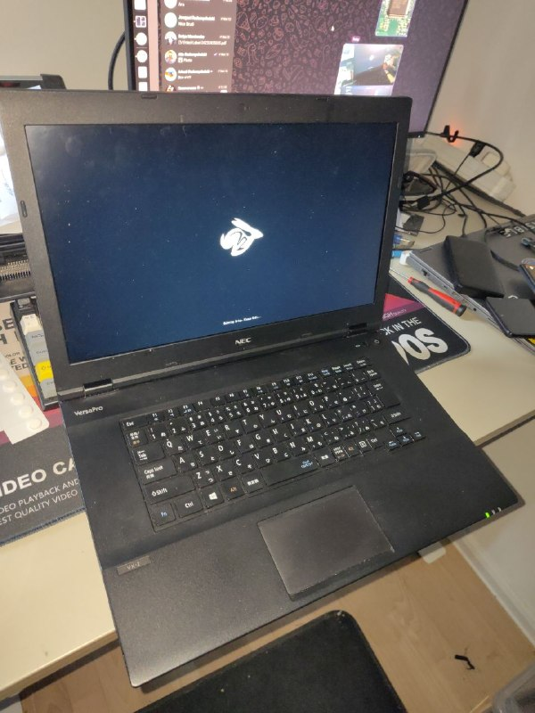
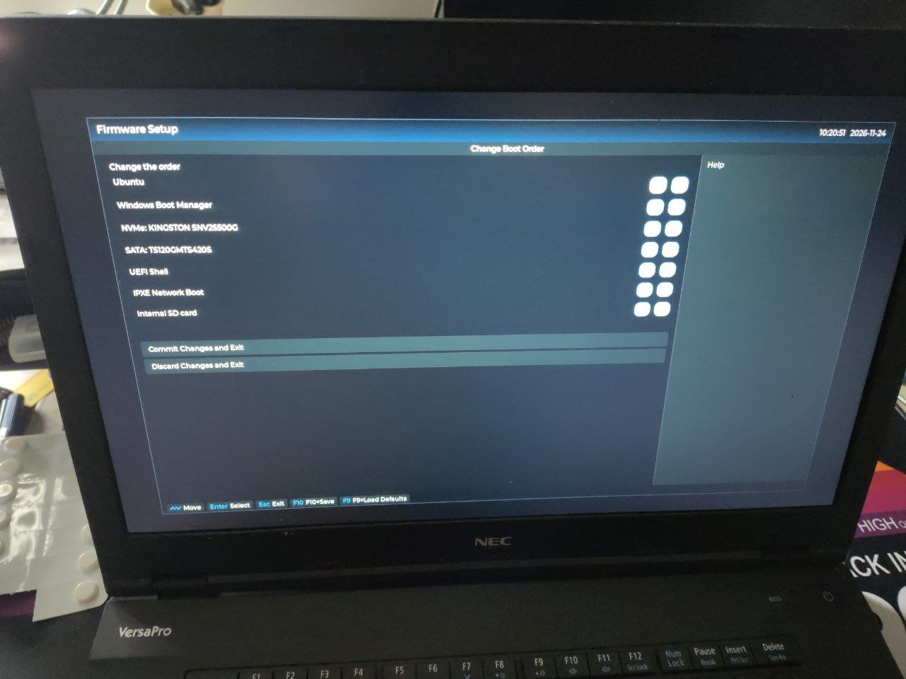

# NEC VersaPro VX-2 — coreboot + EDK2 (experimental port)

## About the notebook

The NEC VersaPro VX-2 tested for this port was built in 2019 in a configuration sold only in Japan. It pairs an 8th-generation Intel Core i5-8250U (Kaby Lake Refresh) with a DB9 serial port, a PCMCIA/CardBus slot, and a built-in CD/DVD writer. By then, these features had largely disappeared from European notebooks. [Intel CPU specifications](https://www.intel.com/content/www/us/en/products/sku/124967/intel-core-i58250u-processor-6m-cache-up-to-3-40-ghz/specifications.html)

The VX-2 (Compal `LA-C423P`) shares much of its mainboard platform with the ThinkPad L560 (`LA-C421P`) and L570 (`LA-C422P`). Each model uses a distinct PCB. The L560 uses DDR3L, while the L570 and VX-2 use DDR4. A coreboot port for either ThinkPad needs its own hardware validation. See [the platform comparison](#porting-reference-for-thinkpad-l570-and-l560) below.

> This repository preserves the experimental NEC VX-2 development work. The cleaned upstream port is maintained as a separate Coreboot change series; its final hardware test is summarized below. The GitHub tree is not a flash image. Keep the experimental source and the upstream port distinct, and do not flash another device's complete image.

## Tested upstream review update — 2026-11-28

The full NEC VX-2 notebook hardware test was reported completed on the cleaned-up upstream test ROM. The tester reports continued support for the dynamically enumerated SD reader, 32-bit CardBus, 16-bit PCMCIA, OEM GOP/EDK2 and previously supported hardware. Individual measurements, exact SD bus number and card models were not supplied for this run. Windows Intel UHD 620 Code 43 remains unresolved; previously open HDMI and other unverified tests are not reclassified.

- [Gerrit #97774](https://review.coreboot.org/c/coreboot/+/97774): generic CardBus bridge window limit programming, commit `9acf4b12a5e9ee5f1b96c64e27deeb23a24f3b70`.
- [Gerrit #97759](https://review.coreboot.org/c/coreboot/+/97759): updated NEC board port, commit `9430870094bdd7754ea89c05441d7b8c54db2621`, dependent on #97774.
- Both uploads succeeded according to the Git push output. Review and new CI approval remain pending; the previous Jenkins Verified+1 was removed as outdated.
- The generic CardBus fix programs base and inclusive limit registers for both memory and both I/O windows, closes invalid/unassigned windows, and retains Memory Window 0 prefetch. The board-local O2Micro initialization remains. Roda RK9's TI CardBus path is also affected but was not separately built or hardware-tested.
- The SD reader uses dynamic PCI bus allocation; the OEM snapshot locates it behind 00:1d.3. Historical physical root-port mapping ambiguities remain; no fixed bus 08 workaround is retained.
- Experimental IGD NVS, DSM/SWSCI, pre-FSP subsystem-ID override and NEC-specific common graphics debug code were removed from the upstream submission, not from the experimental development snapshot.

Test ROM: 16,777,216 bytes, SHA-256 `5e66645f771b2eea21c8275990fc2287b6fc46f9ecb83a0a45d9564a5e0aed13`. Build report: coreboot 26.09, FSP 3.7.6.0, EDK2 `44b9aa144a5ff5ceb843245388fb00c87a06895f`. The tested source revisions were CardBus `94fe8fa9504b97b0bebedbe0d20827d86e886526` (tree `9f07f9069ebc09b47abf22d0db31f958e25b72ae`) and NEC `3e34346260337fd245533e47a40da18ffd45cf12` (tree `d5e6493919820ab1671e49b71811be066d96be89`). Final Gerrit revisions are [#97774](https://review.coreboot.org/c/coreboot/+/97774), CardBus `9acf4b12a5e9ee5f1b96c64e27deeb23a24f3b70`, and [#97759](https://review.coreboot.org/c/coreboot/+/97759), NEC `9430870094bdd7754ea89c05441d7b8c54db2621`; the NEC revision depends on #97774. The CardBus final tree matches the tested tree; NEC changes after the tested source were documentation-only. The final message-footer correction changed neither submitted tree. The ROM and build artifacts have not been independently inspected for this documentation update.

The GitHub source/configuration snapshot remains the experimental development version, not a byte-for-byte copy of the tested upstream source. Use the Gerrit changes for the upstream code. No ROM or proprietary blobs are published by this update.

## Screenshots





See [the detailed final upstream hardware test and provenance](docs/upstream-hardware-test.md).

## Hardware test status

The final-upstream summary above records the latest user-reported test. Fine-grained device observations in the table below preserve earlier development-build history unless a row explicitly says “Final upstream ROM”; they are not new per-device measurements from the final run.


The results below cover the tested coreboot 26.09 builds on the VX-2. See the [test matrix](docs/test-matrix.md) for the hardware and firmware details of each result.

| Hardware or function | Status | Verified result or open test |
|---|---|---|
| Intel graphics under Linux | ✅ Working (OEM GOP) | Intel UHD 620, hardware-accelerated OpenGL 4.6; native libgfxinit caused i915 display timeouts on the complete notebook. |
| Intel graphics under Windows | ❌ Error 43 | Intel 31.0.101.2140; NEC 2019 driver can cause VIDEO_TDR_FAILURE. See [Windows graphics investigation](docs/windows-graphics.md). |
| Internal display and UEFI | ✅ Working | NEC GOP + VBT, graphical EDK II setup and UEFI Shell. |
| External HDMI | ⚠️ Retest needed | No image with coreboot or with the original NEC BIOS on the test board. Linux detects the monitor and reads its EDID under coreboot. The HDMI port is on a daughterboard, and a poor connection is possible. Check the connector and retest with both firmware versions using the same monitor and cable. |
| External VGA | ✅ Working | The tester confirmed video output on the VX-2. |
| USB 2.0 | ✅ Working | USB live boot and USB devices on all five ports. |
| USB SuperSpeed | ✅ Working | SuperSpeed operation confirmed on the VX-2. |
| Pre-boot USB keyboard | ✅ Working | USB keyboard input works before the operating system boots. |
| Internal NVMe and Secure Boot | ✅ Working | Ubuntu booted from NVMe with Secure Boot enabled. |
| Windows 11 with Secure Boot | ✅ Working | Previously verified Windows 11 boot with Secure Boot enabled; native Intel graphics remains broken (Code 43). |
| Secure Boot persistence | ✅ Working | Secure Boot settings persist across restarts. |
| SD reader | ✅ Linux: Working<br>✅ Windows: Working | The SD write test passed under Linux. An SD card was readable under Windows on the earlier bus-08 build; the cleaned upstream ROM was subsequently tested with dynamic bus allocation. |
| Internal WLAN | ✅ Working | Tested with a retrofitted Intel AX200. The VX-2 typically shipped with an Intel 8xxx-series WLAN card. |
| Internal WLAN after resume | ✅ Working | WLAN works after resuming from suspend with the retrofitted Intel AX200. |
| SATA, mSATA and SATA optical drive | ✅ Working | The tester confirmed operation on the VX-2. |
| 32-bit CardBus | ✅ Final upstream ROM: tested | Earlier development builds tested FireWire and USB 2.0 cards under Linux and Windows. The final test confirmed CardBus support; card models and per-OS details were not supplied. |
| 16-bit PCMCIA | ✅ Final upstream ROM: tested | Earlier development builds recorded Linux/Windows data-transfer tests. The final test confirmed support; the user did not supply a final card model or per-OS transcript. |
| 64 MiB CardBus prefetchable window (historical development build) | ⚠️ Earlier Linux allocation warning | The warning was also observed with original NEC firmware. The final upstream test did not provide a separate register dump or this specific warning status. |
| Sound | ✅ Working | The tester confirmed audio playback. |
| Bluetooth | ✅ Working | Bluetooth functionality confirmed on the VX-2. |
| RJ45 Ethernet | ✅ Working | Wired Ethernet functionality confirmed on the VX-2. |
| Suspend/resume | ✅ Working | The VX-2 suspends and resumes successfully. |
| Internal input | ✅ Working | Internal input works on the VX-2. |
| Battery operation | ✅ Working | The VX-2 operates on battery power. |
| Battery charging | ✅ Working | The battery charges. |
| TPM 2.0 under Linux | ✅ Detected | `tpm_tis` detected TPM 2.0 via `MSFT0101:00`. Linux created `/dev/tpm0` and `/dev/tpmrm0`. TPM command and measured boot validation are pending. |


## Development problems and resolutions

| Problem | Change or finding | Result |
|---|---|---|
| Internal panel stayed black with libgfxinit | eDP AUX and external DDC probes failed to read EDID. Switched to the NEC OEM GOP and matching VBT through EDK II. | **Resolved for the internal display**. External VGA works. HDMI detects the monitor but shows no image. |
| Windows Intel graphics Code 43 with OEM GOP | Tested alternative FSP-GOP initialization on TestMB with EDK2 framebuffer handoff. | **Unsuccessful**: Windows still reports Code 43. [Details](docs/windows-graphics.md#fsp-gop-experiment--2026-11-27). |
| Native libgfxinit follow-up | Updated libgfxinit restored eDP and VGA on TestMB; complete notebook showed repeated i915 pipe A/eDP commit and flip timeouts. | **Not adopted**: Windows Code 43 unchanged; Linux regression. Return to OEM GOP reference. |
| HAP/ME hypothesis | Tester reports no effect on Code 43; original NEC BIOS with HAP clear works normally. | No confirmed HAP-only explanation; individual A/B results and ME runtime state not fully recorded. [Details](docs/windows-graphics.md#native-libgfxinit-and-hap-follow-up--2026-11-28). |
| Legacy Intel VGA ROM ran but produced no visible image | VBE modes `0x118` and `0x11b` lit the backlight without visible output. The same OEM GOP and VBT path provided the working display. | **Legacy path failed**. The GOP path showed the logo, graphical setup and UEFI Shell. |
| USB boot was unreliable during bring-up | Tested again after adding the board's USB port configuration and PCIe bring-up changes. | **USB live boot confirmed**. USB devices worked on all five ports. |
| Internal NVMe disappeared with trimmed Intel ME | Restored the full original ME. Tested first with HAP clear, then with HAP set and build-time ME cleaning disabled. | **NVMe boot confirmed with full ME and HAP set**. The earlier reboot loop has no confirmed root cause. |
| UEFI Secure Boot support needed a variable store | Enabled SMMSTORE and MrChromebox EDK II Secure Boot support. | **Enforcement confirmed** by Ubuntu booting from NVMe through shim with kernel lockdown active. |
| Internal WLAN reported a hardware RF-kill block | The OEM GPD9 pad setting alone left the block in place. The fix opens the LPC MMIO window and sets the OEM EC `DCWL` bit during ACPI initialization. | **Internal WLAN confirmed working** with the retrofitted AX200. |
| CardBus prefetchable window allocation failed | The same Linux warning occurs with the original NEC BIOS. | Data-transfer tests passed with the tested cards. |
| Windows reported Code 31 (`STATUS_DEVICE_DATA_ERROR`) for the CardBus bridge | Matched the OEM root-port function and CardBus window order, then tested the OEM-derived register writes in the UEFI Shell. A partial sequence removed the `1217:8150` companion function from Windows while Code 31 persisted. The complete sequence for `1217:8134` was then added late in coreboot ramstage. | **Resolved**. FireWire and USB 2.0 CardBus cards and a 16-bit PCMCIA card reader passed data-transfer tests under Linux and Windows. |
| Windows could not use the internal SD reader during early bring-up | An experimental build temporarily preserved OEM bus `08`. That fixed assignment was removed from the upstream port. | **Final upstream ROM tested with dynamic Coreboot bus assignment**; the observed bus number was not supplied. |
| HDMI detects the monitor but produces no image | Linux read EDID under coreboot. The test board also produced no HDMI image with the original NEC BIOS. HDMI is on a daughterboard, and its connector still needs inspection. | **Open**. Retest both firmware versions after checking the daughterboard connection. |
| Windows still listed an Intel multimedia controller (`8086:1919`) | The current board devicetree sets `imgu` to `off`. | **Open**. Whether `8086:1919` still enumerates with the latest firmware has not been verified. |
| TPM 2.0 devices were absent in Linux | Added the coreboot LPC TPM driver node. | **Linux detection restored** via `tpm_tis`. |

## Hardware / software

- System: NEC VersaPro VX-2, Compal LA-C423P (board identification from porting work)
- CPU: Intel Core i5-8250U (Kaby Lake-R)
- iGPU: Intel UHD Graphics 620, PCI ID `8086:5917`
- EC: Nuvoton NPCE388N
- SPI flash: Winbond W25Q128BV (SOIC-8), 16 MiB. Tested with an external T48 programmer. The `minipro` device name is `W25Q128BV@SOIC8`.
- Firmware: coreboot build based on the user's coreboot 26.09 development tree, EDK2 MrChromebox payload

### CardBus, SD reader and serial port

| Interface | Controller or hardware ID | Linux driver and observed status |
|---|---|---|
| CardBus / PCMCIA | O2 Micro **OZ600TJ0TN** (`U17`), PCI bridge `1217:8134`, rev. `06`. Companion function `1217:8150` is classified as mass storage. | Linux uses `yenta_cardbus`. FireWire and USB 2.0 CardBus cards and a 16-bit PCMCIA card reader passed data-transfer tests under Linux and Windows. |
| SD / MMC | O2 Micro SD/MMC reader, PCI `1217:8621`, rev. `01`. Listed as `OZ711` in the PCI ID database. The exact chip marking and variant are unverified. | `sdhci-pci`. SD write test passed. |
| Serial port (COM1) | Legacy 16550A-compatible UART, I/O base `0x3f8`, IRQ `4`, base baud `115200` as reported by Linux. | `serial8250` enumerates `ttyS0`. The physical connector and transmit/receive operation have yet to be verified. |

## Porting reference for ThinkPad L570 and L560

The NEC VX-2 port can serve as a starting point for a separate **ThinkPad L570** port. The L570's mobile Skylake/Kaby Lake platform is closely related, and it also uses DDR4. The **ThinkPad L560** is another candidate for investigation. Its Skylake platform shares some of the same initialization work, and its DDR3L memory requires a separate RAM initialization configuration. The results in this repository are from the NEC VX-2. Both Lenovo models require their own hardware validation.

| Hardware | NEC VersaPro VX-2 (tested unit) | ThinkPad L570 (Lenovo PSREF) | ThinkPad L560 (Lenovo PSREF) |
|---|---|---|---|
| Compal PCB | `LA-C423P` on the tested unit | `LA-C422P` (CILL1/CILL2) | `LA-C421P` (AILL1/AILL2) |
| CPU and integrated graphics | Core i5-8250U (Kaby Lake-R, 4 cores), UHD 620 | Skylake or Kaby Lake variants, HD 520, 610 or 620 | Skylake variants, HD 510 or 520 |
| Memory | Two DDR4 SO-DIMM slots | Two DDR4 SO-DIMM slots | Two DDR3L SO-DIMM slots |
| External display | External VGA works. HDMI detects the monitor but shows no image. | VGA and Mini DisplayPort | VGA and Mini DisplayPort |
| Internal storage | NVMe boot verified with a PCIe adapter in the 2.5-inch drive bay. SATA, mSATA and SATA optical drive operation also confirmed | 2.5-inch SATA or M.2 PCIe NVMe in the same drive bay with a dedicated adapter. Optional M.2 SATA storage in the WWAN slot on some configurations | 2.5-inch SATA HDD, SSD or SSHD configurations listed |
| Expansion | 32-bit CardBus and 16-bit PCMCIA confirmed working under Linux and Windows. Five physical USB ports | Optional ExpressCard/34, four USB ports, ThinkPad dock connector | Optional ExpressCard/34, four USB ports with speeds depending on model, ThinkPad dock connector |
| TPM | OEM firmware exposed TPM 2.0 via Linux `tpm_tis`. The fixed coreboot build also enumerates it | Discrete TPM 2.0 | Lenovo lists discrete TPM 1.2 and chipset firmware TPM 2.0 |

Reuse the related Intel SoC initialization and the VX-2 bring-up workflow for memory, graphics and PCIe. For each Lenovo board revision, determine the DIMM/SPD configuration, GPIO and PCIe routing, EC interface and ACPI methods, panel configuration, TPM transport, and SPI layout from that target. The VX-2 WLAN fix is a reference for tracing an EC-controlled radio block. Its MMIO address and EC bit are specific to the tested NEC implementation. Use the target's own firmware dump and board-specific components. **Flash the VX-2 image only on the VX-2.**

### NVMe adapter for the 2.5-inch drive bay

The NEC VX-2 boots from an M.2 2280 PCIe NVMe SSD installed in a direct-plug caddy in the 2.5-inch drive bay. The caddy's onboard connector mates directly with the PCIe-capable drive-bay connector. No separate cable is required. The same bay can also accept a 2.5-inch SATA drive.

The tested caddy is marked **`AM1SS000100`** on the metal tray. Search for that marking when comparing replacements. The [ThinkPad L570 hardware maintenance manual](https://download.lenovo.com/pccbbs/mobiles_pdf/l570_hmm_en_sp40k88826_02.pdf) describes an M.2 adapter for its internal drive bay, and [a photographed L570 spare](https://www.ebay.de/itm/285449995050) is listed with the same marking. The project verified NVMe boot on the VX-2. L560 compatibility and an official FRU mapping for the photographed NEC caddy remain unverified.


The schematic indexes for [L570 LA-C422P](https://awesomeheader.com/model/lenovo-thinkpad-l570/) and [L560 LA-C421P](https://eletronicabr.com/en/files/file/44855-lenovo-l560-notebook-electrical-schematic-aill1-aill2-and-la-c421p-rev-10-schematic/) identify different PCBs. Prioritize the L570 for a new port based on the VX-2 work. For the L560, use the VX-2 as a reference for SoC bring-up and derive board initialization from the LA-C421P schematic and target firmware. The PCB identifiers alone do not establish shared routing.

Lenovo references: [ThinkPad L570 platform specifications](https://psref.lenovo.com/syspool/Sys/PDF/ThinkPad/ThinkPad_L570/ThinkPad_L570_Spec.PDF), [ThinkPad L570 model configurations](https://psref.lenovo.com/Product/ThinkPad_L570), [ThinkPad L560 platform specifications](https://psref.lenovo.com/syspool/Sys/PDF/ThinkPad/ThinkPad_L560/ThinkPad_L560_Spec.PDF).

## Build configuration

The final upstream test used Coreboot 26.09, the generic CardBus window fix and dynamic PCI enumeration for the SD reader. Its local ROM checksum and immutable source revisions are recorded in [build provenance](docs/build-provenance.md). The complete ROM and OEM flash blobs are intentionally not distributed. The configuration details below describe the preserved experimental OEM-GOP reference unless explicitly identified as upstream.


The reference configuration enables LVGL and uses the original 16 MiB SPI layout with an 8 MiB BIOS region. It incorporates the verified HAP descriptor path, full ME input, SMMSTORE, and EDK II Secure Boot support. Secure Boot starts disabled by default and can be enabled in setup. The reference uses the current local development checkout’s configuration. The previous reference came from a known-good ROM captured on 2026-11-24. See [build provenance](docs/build-provenance.md). The reference disables persistent SPI console logging and keeps CBMEM logging and SMMSTORE enabled.

The following combination was confirmed to show the **coreboot logo through EDK2**, followed by a functional UEFI Shell:

```text
CONFIG_NO_GFX_INIT=y
# CONFIG_VGA_ROM_RUN is not set
CONFIG_INTEL_GMA_ADD_VBT=y
CONFIG_EDK2_REPO_MRCHROMEBOX=y
CONFIG_EDK2_GOP_DRIVER=y
CONFIG_EDK2_USE_LVGL_RENDERER=y
CONFIG_EDK2_GOP_FILE="3rdparty/blobs/mainboard/nec/vx-2/IntelGopDriver.efi"
CONFIG_INTEL_GMA_VBT_FILE="3rdparty/blobs/mainboard/nec/vx-2/IntelGopVbt.bin"
```

The reference configuration is in `config/coreboot.config` with the device serial number cleared.

EDK2 uses coreboot’s bundled logo (`Documentation/coreboot_logo.bmp`) in the reference configuration.

## Firmware component provenance

The original OEM firmware report contained:

| Module | UEFI file GUID | Extracted payload |
|---|---|---|
| IntelGopDriver | `FF0C8745-3270-4439-B74F-3E45F8C77064` | x86-64 PE32+ EFI boot-service driver, 69,568 bytes |
| IntelGopVbt | `878AC2CC-5343-46F2-B563-51F89DAF56BA` | raw VBT, 4,608 bytes; starts with `$VBT SKYLAKE` |

The working VBT had SHA-256 `407ceb6c1a3eafafc9aa441207bc23d69728465ebc046997d300b7052da2ad33`.

**Do not publish OEM binaries, full SPI dumps, ME/BIOS regions or device-specific NVRAM unless you have verified redistribution rights and removed confidential/device-specific data.** This repository is configured to exclude them by default. See [OEM asset instructions](docs/oem-assets.md).

## Experimental development: Combined V2 and IGD subsystem ID

Combined V2 boots on the NEC VX-2 with 128 MiB DVMT preallocation, an 8 MiB
GGTT and a 256 MiB graphics aperture. Its OEM GOP and VBT are paired with
a Post-GOP DXE driver for EDID and panel brightness handoff to the ACPI NVS
OpRegion. The graphics NVS and ACPI _DSM extensions are included. The
SWSCI handlers remain present in AML with the original disabled
activation status.

**Windows still reports Code 43 with Combined V2.** The new coreboot
SID correction targets PCI `00:02.0`, DWORD `0x2C`, with expected value
`0x60CF17AA` and Windows hardware ID
`PCI\VEN_8086&DEV_5917&SUBSYS_60CF17AA`. Hardware diagnostic 02 confirms the expected ID. Windows with the 2025 Intel driver still reports Code 43; the 2019 NEC driver causes VIDEO_TDR_FAILURE. Linux graphics works. See the dedicated [Windows graphics investigation](docs/windows-graphics.md).

The source overlays, patches, complete sanitized configuration and
EFI diagnostic sources are included. Follow the
[Combined V2 build instructions](docs/combined-v2-build.md) and see the
[IGD SID analysis](docs/igd-ssid.md) for the observed values and correction.

See also the [development notes](docs/development-notes.md) and
[hardware test matrix](docs/test-matrix.md).

## License and acknowledgments

Documentation and original repository helper scripts can be released under a permissive license by the author. Coreboot, EDK2, libgfxinit and OEM components retain their respective licenses. This project is **not affiliated with NEC, Intel, Coreboot or MrChromebox**. Do not assume license rights to redistribute extracted OEM firmware.
